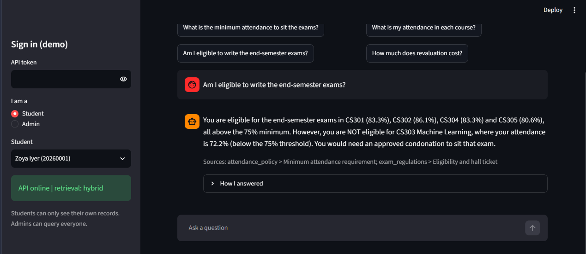

# CampusMind: AI Academic Assistant

An assistant for university policies and student data. A question goes to an **LLM agent** that chooses between
**hybrid document retrieval (RAG)**, a **guarded text-to-SQL tool**, both, or a refusal, and answers with verified sources.
Built with Python, FastAPI, Streamlit, SQLite, BM25 + embeddings, and a provider-agnostic LLM client.



```
Question ──> LLM agent ──┬─> search_docs ──> BM25 + embeddings, merged with Reciprocal Rank Fusion ──> policy documents
 (student/admin)         ├─> query_sql  ──> guard ─> read-only DB ─> row-level scope ─> limit + timeout
                         └─> refuse (out of scope)
                                  │
                      Answer + verified sources + the SQL that ran
```

## Quick start (Windows)
```powershell
.\setup.ps1          # venv, dependencies, fake database, tests (creates .env on first run)
# open .env: set LLM_PROVIDER and the matching API key
.\start.ps1          # API on :8000 and chat UI on :8501
```
Mac/Linux: `python -m venv .venv && source .venv/bin/activate && pip install -r requirements.txt && python -m data.seed && pytest`, then
`uvicorn app.api:app --port 8000` and `streamlit run ui/chat.py`.
Docker: `docker compose up --build`, then open http://localhost:8501.

## What it does
| Question | Route | Example |
|---|---|---|
| Policy / syllabus | document search, cited answer | "How much does revaluation cost?" |
| Data | guarded SQL, shows the query and the table | "Which students are below 75% in CS301?" |
| Data + policy | both tools, then compares | "Am I eligible to write the exams?" |
| Out of scope | refusal, no guessing | "What is on the cafeteria menu?" |

## Design decisions worth knowing
- **Hybrid retrieval.** BM25 wins when the question reuses the document's words, embeddings win on paraphrases. Reciprocal Rank Fusion merges the *ranks*, so scores on different scales never need normalizing.
- **Text-to-SQL is treated as untrusted input.** Five layers, each with its own tests: (1) a parser-based validator allows one SELECT on allowlisted tables only and rejects schema-qualified names, table functions and dangerous functions; (2) a read-only SQLite connection plus `PRAGMA query_only`; (3) an authorizer that only permits SELECT/READ; (4) row-level scoping, where for students TEMP views shadow every table so no query, join, subquery or UNION can see another student's rows; (5) a row limit and a timeout.
- **The agent's claims are checked, not trusted.** Citations must point at passages that were really retrieved (invented sources are dropped), and an answer before any tool call is rejected.
- **Provider-agnostic.** One interface over Anthropic, OpenAI, Groq and Gemini (`LLM_PROVIDER` in `.env`). Tested with scripted fake models, so the whole agent loop runs offline in tests.
- **Cost and abuse protection.** Optional `API_TOKEN` / `ADMIN_TOKEN`, a per-IP rate limit, token and latency logging per question (`data/logs/interactions.jsonl`, no row data stored).

## Evaluation
Both evaluations were run on this repository's synthetic data. The agent used `qwen/qwen3.8-27b` through Groq's free tier, and retrieval used `BAAI/bge-small-en-v1.5` embeddings. The commands shown reproduce them.

**1. Retrieval** (33 questions, no LLM needed): `python -m eval.run_eval --all`
<!-- retrieval-results:start -->
| Retriever | hit@1 | hit@3 | hit@5 | MRR | ms/query |
|---|---|---|---|---|---|
| bm25 | 67% | 79% | 85% | 0.739 | 0.3 |
| dense | 82% | 91% | 97% | 0.877 | 12.59 |
| hybrid | 85% | 94% | 97% | 0.895 | 11.4 |
<!-- retrieval-results:end -->

**2. Agent end to end** (needs an LLM key): `python -m eval.agent_eval`
<!-- agent-results:start -->
| Category | Questions | Pass rate |
|---|---|---|
| Document questions (cited the right document) | 33 | 100% |
| Unanswerable questions (refused) | 6 | 100% |
| Text-to-SQL (execution accuracy) | 17 | 88% |
| Data + policy (both tools, right citation) | 5 | 100% |
| **Overall** | 61 | **97%** |

Read the table per category: the categories range from 5 to 33 questions, so the overall figure is only a rough summary. "Cited the right document" checks the source, not the wording of the answer. Two text-to-SQL questions (sql07 and sql09) did not match the gold result. Latency was measured on a free API tier and may include rate-limit waits.

False refusal rate 0% | SQL error rate 4% | avg 2.1 steps, 2571 tokens, 12.27s per question
<!-- agent-results:end -->

Scoring is deterministic: citation of the right document, refusal of unanswerable questions, and *execution accuracy* for SQL
(the agent's query returns the same rows as a hand-written gold query). Answer wording is not auto-scored.

## Tests
`pytest` runs about 200 tests with no network or API key: SQL guard and sandbox (including attempts to escape student scope),
chunking, retrieval and fusion math, every LLM adapter against mocked HTTP, the agent loop with a scripted model,
the API (auth, rate limit, errors), the chat UI (headless), and the evaluation harness itself.
`RUN_EMBEDDING_TESTS=1 pytest` also runs the test that downloads the real embedding model.

## Project layout
| Path | Purpose |
|---|---|
| `app/agent.py`, `prompts.py` | the agent loop and its system prompt |
| `app/retrieval.py`, `embeddings.py`, `chunking.py` | BM25, dense and hybrid retrieval; chunking |
| `app/sql_guard.py`, `sql_tool.py` | SQL validation and the sandboxed executor |
| `app/llm.py` | multi-provider LLM client with retries |
| `app/api.py`, `services.py`, `telemetry.py` | FastAPI service, wiring, logging |
| `ui/chat.py` | Streamlit chat page |
| `data/docs/`, `data/seed.py` | policy documents and the synthetic database |
| `eval/` | retrieval and agent evaluations, question sets |
| `Dockerfile`, `docker-compose.yml`, `.github/workflows/ci.yml` | container and CI configuration (the Docker image has not been built or tested yet).|

## Deploying
A Dockerfile and compose file are included but untested. Before any public deployment, set API_TOKEN, ADMIN_TOKEN and a low RATE_LIMIT_PER_MIN, because every question spends LLM credits.

## Limitations (stated honestly)
- All data is synthetic, and the document corpus is small and written by the author, so absolute retrieval numbers are optimistic; compare methods against each other.
- `role` and `student_id` are sent by the client. That is acceptable for a demo; a real system must take identity from the university's login (SSO/JWT).
- Column-level restrictions are not enforced (table allowlist and row-level scoping are). The synthetic data has no sensitive columns.
- Answer quality depends on the chosen LLM; prompts may need tuning for your model. Use `eval.agent_eval` to measure, then change one thing at a time.
- The flat numpy index is exact and instant at this size; a vector database would add complexity without benefit here.
- - The two gpt-oss models available on Groq returned their JSON in a reasoning field or tried to call tools instead of following the reply format, so this project uses Qwen (found with scripts/probe_llm.py). Other models may need prompt changes.
- Hybrid and dense retrieval differ by one question out of 33, so that gap is not meaningful. Both clearly beat keyword search on this set.
